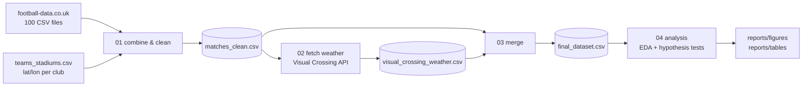
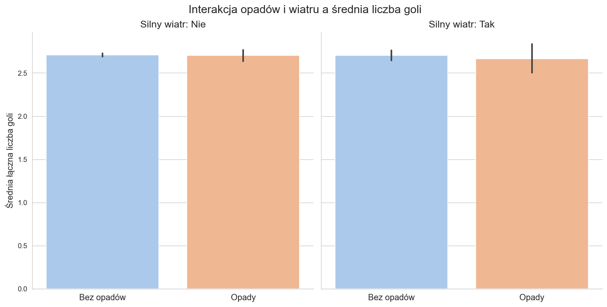
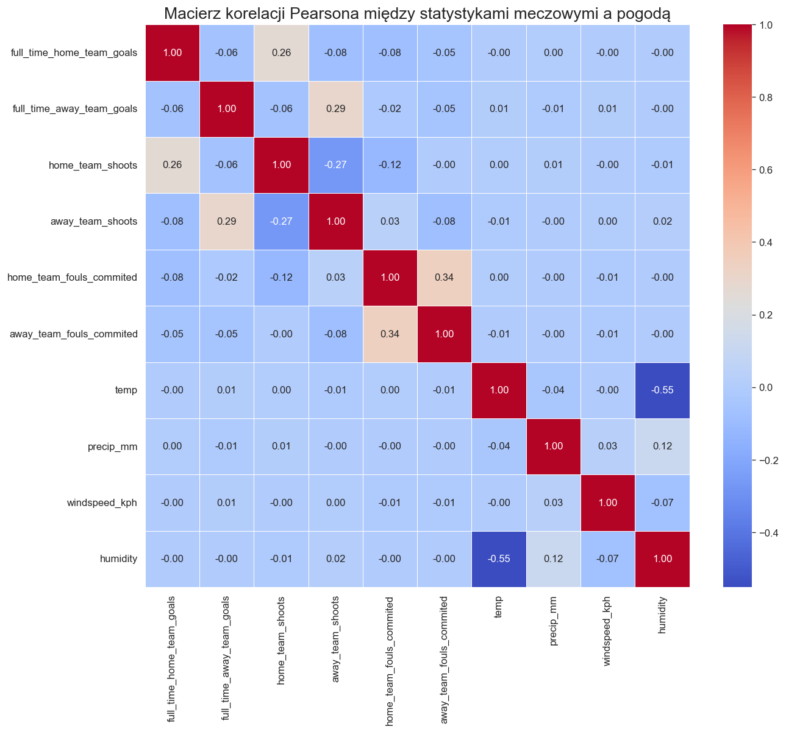
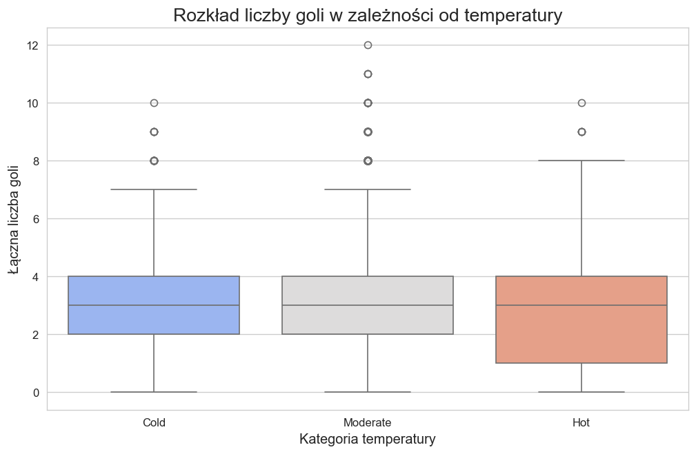
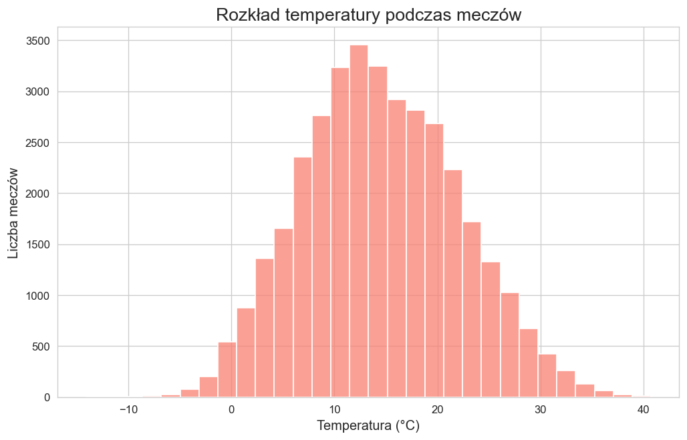

# Does the weather affect football matches?

An end-to-end data project that combines **36,271 matches** from Europe's top 5 leagues (2005/06–2024/25) with **historical hourly weather** at each stadium at kick-off time, then tests whether temperature, rain and wind change the number of goals, fouls and cards.

Based on my engineering thesis. Notebooks are commented in Polish.

## Highlights

- **Data integration**: 100 raw CSV files from two different date formats and inconsistent headers merged into one dataset; stadium geolocation joined from a hand-built reference table of 200+ clubs.
- **API ingestion**: ~36k requests to the Visual Crossing Timeline API, processed in resumable chunks with row-count auditing.
- **Data quality**: imputation of missing kick-off times, removal of sparse columns (>10% missing), key-based joins validated as one-to-one, and a documented date-parsing defect with a robustness check (see [Known limitations](#known-limitations)).
- **Statistics**: descriptive stats, Pearson correlations, Welch's t-test, 95% confidence intervals, Cohen's d and power analysis.

## Pipeline



| Notebook | What it does |
|---|---|
| [`01_combine_and_clean_matches`](notebooks/01_combine_and_clean_matches.ipynb) | Loads 5 leagues × 20 seasons, normalises dates, joins stadium coordinates, imputes missing kick-off times |
| [`02_fetch_weather_data`](notebooks/02_fetch_weather_data.ipynb) | Fetches weather for every match in 20 resumable chunks (skipped if the weather file already exists) |
| [`03_merge_matches_weather`](notebooks/03_merge_matches_weather.ipynb) | Drops sparse columns, joins weather on the match key, renames columns to snake_case |
| [`04_analysis`](notebooks/04_analysis.ipynb) | EDA, hypothesis tests H1 and H2, effect size, power analysis, robustness check |

## Results

**H1: single weather factors.** Mean total goals barely change with temperature (2.70 / 2.71 / 2.69 for cold / moderate / hot), rain (2.71 vs 2.69) or wind. Fouls behave the same way. Yellow cards rise slightly with temperature (3.87 → 4.19 per match). Correlations between match stats and weather are close to zero.

**H2: rain *and* strong wind together.** The 415 matches with both averaged 2.66 goals vs 2.71 for all other matches.

| Group | n | Mean goals | 95% CI |
|---|---:|---:|---|
| Normal | 35,856 | 2.708 | 2.690 – 2.725 |
| Rain + strong wind | 415 | 2.663 | 2.499 – 2.827 |

Welch's t-test: t = −0.54, **p = 0.59**. Cohen's d = 0.027, so the effect is negligible. Detecting it with 80% power would need about 21,600 matches in *each* group.

**Conclusion:** in top-level European football, weather conditions at kick-off have no practically meaningful effect on goals or fouls.

<p>
  
  
</p>
<p>
  
  
</p>

All figures are in [`reports/figures`](reports/figures) and summary tables in [`reports/tables`](reports/tables).

## Known limitations

- **Date parsing defect (found while preparing this repository).** In the original thesis pipeline, dates with a day ≤ 12 were read as month/day (e.g. 10 Aug 2007 became 8 Oct 2007). As a result, weather for **12,562 matches (34.6%)** was requested for the wrong day. The parsing is fixed in notebook 01. The affected rows are flagged in the weather file (`date_was_swapped`), and the analysis repeats the H2 test using only correctly dated matches: the conclusion does not change (p = 0.81, n = 23,709). Re-fetching weather for the flagged rows is the next step.
- Kick-off times are missing for older seasons and are imputed (17:00 at weekends, 21:00 on weekdays).
- Weather is a single hourly observation at kick-off, not an average over the full 90 minutes.
- Fouls and cards depend heavily on the referee and the competition, which this analysis does not control for.

## Data

| Source | Location | Notes |
|---|---|---|
| [football-data.co.uk](https://www.football-data.co.uk/data.php) | `data/raw/football-data/` | Premier League (`E0`), Bundesliga (`D1`), La Liga (`SP1`), Serie A (`I1`), Ligue 1 (`F1`); file name `<league>_<season>.csv` |
| Own work | `data/reference/teams_stadiums.csv` | Home stadium, city and coordinates for every club |
| [Visual Crossing Weather API](https://www.visualcrossing.com/weather-api) | `data/external/visual_crossing_weather.csv` | Weather at kick-off, keyed by `Division, Season, HomeTeam, AwayTeam` |

Files in `data/processed/` are generated by the notebooks and are not tracked by git.

## How to run

```bash
git clone https://github.com/DominikBieniarz/football-weather-analysis.git
cd football-weather-analysis
python -m venv .venv && source .venv/bin/activate
pip install -r requirements.txt
jupyter notebook notebooks/
```

Run the notebooks in order 01 → 04. The weather data is already included, so notebook 02 skips the download by default. To fetch it again, set `REFRESH = True` and provide an API key:

```bash
export VISUAL_CROSSING_API_KEY=your_key_here
```

## Tech stack

Python 3.9+ · pandas · NumPy · requests · SciPy · statsmodels · Matplotlib · seaborn · Jupyter
